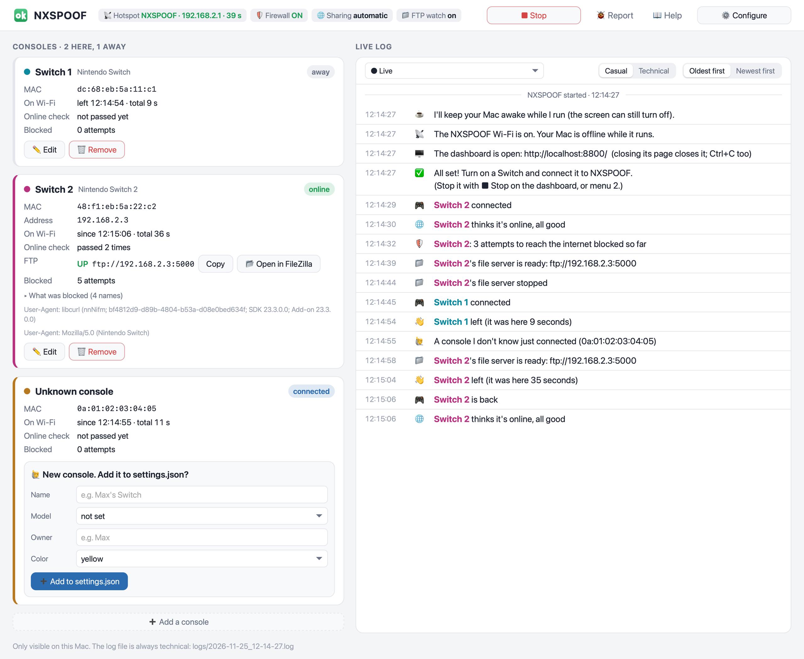

<p align="center"></p>

# NXSPOOF

> Nintendo's test page answers with one word: **ok**. That's the only "yes" NXSPOOF ever says. *It's learning "maybe".*

Your Mac becomes a Wi-Fi hotspot for Nintendo Switch and Switch 2 consoles that answers **only** their "am I online?" test and blocks everything else. The consoles believe they're online, so whatever needs a network keeps working (an FTP app on the console talking to your Mac, for instance), while nothing reaches Nintendo or the internet.

> **Heads-up: no internet for your consoles, yet.** Anything that genuinely needs the internet won't work today. Next on the list: real internet, but only where you choose, per console. Until then, NXSPOOF has exactly one setting for the internet, and it's "no".

<picture>
  <source media="(prefers-color-scheme: dark)" srcset="docs/images/dashboard-dark.png">
  
</picture>

<sub>A simulated session (made-up consoles): `menu.command` → 8 → 4 shows the same thing on your Mac, no Switch needed.</sub>

## What you can do with it

- **Get your Switch "online", with zero internet.** It passes its connection test and says "connected", and nothing reaches Nintendo: no update sneaks in, no sign-in, no telemetry.
- **Move files between your Switch and your Mac,** with an FTP app on the console: NXSPOOF spots it and opens it in FileZilla in one click.
- **See everything your Switch reaches for,** live, per console. Watching what a Switch tries once it thinks it's online is half the fun.
- **Keep your Mac online,** if it's also on Ethernet. The consoles still get nothing.
- **Manage your consoles, audit every session,** and set up or undo everything in one go. NXSPOOF keeps an eye on the hotspot for you.

How it pulls that off, in ten minutes and without code: [How it works](https://whaaooo42.github.io/nxspoof/how-it-works.html). All the docs are HTML pages in [`docs/`](https://whaaooo42.github.io/nxspoof/index.html), which work offline: the dashboard shows them under **📖 Help**.

## Made for the Mac

It's all on the Mac you already have: the hotspot, the name answers, Nintendo's test page and a real firewall (pf), with nothing to install or change on the consoles: they just join the Wi-Fi. As far as we can tell, it's the only ready-made tool that does this on a Mac (tell us if we're wrong: we'd like to know).

Not on a Mac, or after something different? Other people got there too, each their own way:
- [90DNS](https://a.gitlab.io/90dns/): a public DNS service that blocks Nintendo and answers the test. Nothing to install.
- [SwitchNest-Hotspot](https://github.com/blueshockz47/SwitchNest-Hotspot): a Linux PC or a Steam Deck as the hotspot, with an FTP file manager and more.
- [switch2-ethernet-offline](https://github.com/fernando-granco/switch2-ethernet-offline): a Windows PC, over a cable.
- [luci-app-switch2-block](https://github.com/xbcyl813/luci-app-switch2-block): an OpenWrt router does it, per console.
- [Ningandi](https://github.com/Gandinga/Ningandi): a recipe for Windows, Linux, Android and the Mac, with your own hotspot and the console's DNS set by hand.
- [mac2jb](https://github.com/cpypwn/mac2jb): a Switch 2 jailbreak toolkit for the Mac whose offline mode answers the test over a cable (don't run it at the same time as NXSPOOF: both use ports 53 and 80).
- On a console running custom firmware: [Atmosphère's DNS MITM](https://switch.hacks.guide/extras/blocking_nintendo).

## Where it stands

**An early, solid foundation, not a do-everything tool.** It was built around one thing first: the consoles get no internet at all. They pass their test, they can talk to your Mac, and every other attempt is turned away and logged. Tested in nine checked runs with a Switch and two Switch 2s.

**Ideas on the table** (none promised, all open to discussion):
- **Allowlist mode**: real internet through an Ethernet adapter, but only to the destinations you choose, per console.
- **A Requests inbox**: every blocked attempt becomes a card you allow or deny in one click (once, always for this console, or for all).
- **A shared blocklist** of servers that must never be reached, from your own list and community sources.
- **Per-console services and rules** beyond the FTP watch.
- **Linux, and a Raspberry Pi version**: everything Mac-specific already sits behind one small layer, so a Linux layer (NetworkManager or hostapd for the hotspot, nftables for the firewall) is realistic. On a Pi, NXSPOOF would become a cheap, always-ready box with the whole dashboard.

**About accounts and Nintendo's terms:** NXSPOOF makes no promise about bans or about what Nintendo may decide. It tells you exactly what it does to the network; what you do with your consoles is up to you.

**It's shared to hear from you:** is it useful to you? What would make it useful? What's missing, wrong, or done better elsewhere? Feedback, ideas and pull requests are all welcome.

## What it changes on your Mac

Nothing happens behind your back: each change is listed in the dashboard's **⚙️ Configure** (its **This Mac** column), done only after you say so (and your Mac password), and undone with **↩ Undo setup**.

- **Thunderbolt Bridge** gets a fixed private address (172.16.0.1, or 10.254.0.1 / 192.168.254.1 if you prefer): Internet Sharing needs a "source" to share from, and this is a dead link that goes nowhere.
- **A virtual cable** (two virtual interfaces, gone at every restart) makes that bridge look plugged in.
- **The hotspot itself is never touched.** Its name, channel and password stay macOS's: you set them once in System Settings (Internet Sharing's **Wi-Fi Options**), and NXSPOOF only reads them, to show you the name and check there's a password. (Writing them behind macOS's back breaks the password: tried, and dropped.)
- **While NXSPOOF runs:** Internet Sharing is on, a firewall (pf) lets the consoles reach only the Mac's DHCP, DNS and the fake connection test, and NXSPOOF answers DNS and that test. When it stops, all of that is removed and sharing goes off. If it ever crashes, its small root part cleans up anyway (or the dashboard offers **🧹 Clean up**).
- **Your Mac goes offline while NXSPOOF runs** (its Wi-Fi becomes the hotspot)... **unless it's also on Ethernet** (a USB-C adapter does it): then your Mac stays online the whole time, and the consoles still get nothing, because NXSPOOF never shares that connection.
- **Any device can join the hotspot**, not only Switches: they all get an address and the same firewall, but only a Switch gets the connection-test answer; everything else is refused, for every device.

Only a tiny part of NXSPOOF runs as root (the firewall, sharing, the cable, opening ports 53 and 80); everything else, including the code that reads what the consoles send, runs as you. The dashboard listens on 127.0.0.1 only.

## What you need

- A Mac with Wi-Fi (made for macOS 15, Sequoia) and an administrator account.
- Apple's Python 3 (it comes with Apple's Command Line Tools). If it's missing, `NXSPOOF.app` (and every `.command` file) says so the first time you open it, and macOS offers to install them.
- Nothing else: no Homebrew, no pip, no downloads.

## Quick start

1. **Get the folder**, anywhere you like (Documents, Downloads, your home folder): on this page, **Code → Download ZIP**, then double-click the zip. Or, with git:
   ```bash
   git clone https://github.com/Whaaooo42/nxspoof.git
   ```
2. **Double-click `Create NXSPOOF.app.command`** in it, once: it builds `NXSPOOF.app` (the usual door) on your Mac, then opens it. macOS may ask whether you want to open the script: it's from the folder you just got.
3. From then on, **double-click `NXSPOOF.app`**: the dashboard opens in your browser. The first time, macOS asks whether NXSPOOF may use the folder it's in: click **Allow**.
4. **⚙️ Configure** (top right; **✋ 2** means two things need you), **This Mac** column: press **🛠️ Fix selected** (one password, in macOS's own window). If it says the hotspot has no password, its line has **Open System Settings → Sharing**: ⓘ next to Internet Sharing → **Wi-Fi Options…**, then pick the name (NXSPOOF, for example), channel and password there.
5. Optional: in the same view, another bridge address (on Thunderbolt Bridge's line) or any other setting (right column), then **Save** in the bar that appears at the top. **← Dashboard** goes back.
6. **▶ Start NXSPOOF**, your password, wait for **READY**.
7. On each Switch: System Settings → Internet → join your hotspot (the dashboard's 📡 chip shows its name). Its connection test passes. A console NXSPOOF doesn't know yet shows up on the dashboard with **Add this console**.
8. **■ Stop** when you're done.

Then: the [guide](https://whaaooo42.github.io/nxspoof/guide.html) (the everyday things), [troubleshooting](https://whaaooo42.github.io/nxspoof/troubleshooting.html) (with a search box), the [reference](https://whaaooo42.github.io/nxspoof/reference.html) (every setting, option, command and file). Something wrong? **🐞 Report** on the dashboard makes a report for an issue (this Mac, its setup, the last runs' problems, names replaced), shown before it's copied. Prefer the Terminal? `menu.command` does everything ([the two doors](https://whaaooo42.github.io/nxspoof/two-doors.html)), and `python3 -B nx_spoof.py --help` lists every command and option.

## Where things live

- **The program:** this folder. NXSPOOF never writes into it (so `git pull` stays clean), apart from the `data` shortcut, and `NXSPOOF.app` once you build it.
- **Your settings and logs:** `~/Library/Application Support/NXSPOOF/` (the `data` shortcut in the folder opens it): `settings.json`, one log per run, and a note of how your Mac was before NXSPOOF first changed it (for Undo).

## Removing it

On the dashboard, **⚙️ Configure → ↩ Undo setup…** (back to how your Mac was, or macOS's defaults); close it, then delete the nx-spoof folder and `~/Library/Application Support/NXSPOOF` ([details](https://whaaooo42.github.io/nxspoof/setup.html#removing)).

## How it's built

[How it's built](https://whaaooo42.github.io/nxspoof/how-its-built.html): the layers, the rules the code keeps (checked by the tests: `python3 -B tools/run_tests.py`), every module; [Decisions](https://whaaooo42.github.io/nxspoof/decisions.html): each choice and its why. Standard-library Python 3.9 only.

## License

MIT (see [LICENSE](LICENSE)): use it, change it, share it. It comes with no warranty, and no promise about what Nintendo may decide (see "About accounts and Nintendo's terms" above).
